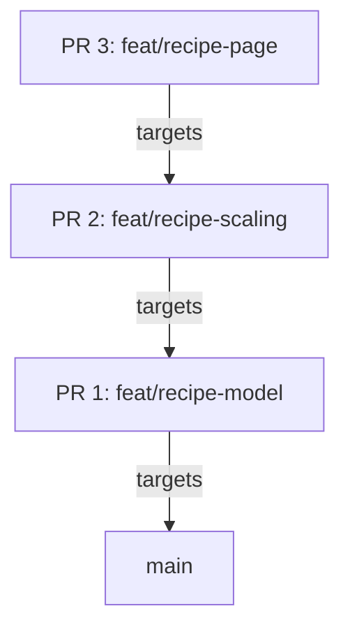

## Step 3: Add the top layer and create the stack

Two layers are pushed. One more layer, then you'll turn the branches into linked pull requests.

### 📖 Theory: Creating and reading a stack

A stack is a chain of pull requests. Each one targets the branch below it, and the first targets `main`:



When GitHub sees a chain like this, it offers to link the pull requests as a stack. Once linked, each pull request shows a stack icon, and the merge box shows a stack map of every layer.


#### References

- [Creating stacked pull requests](https://docs.github.com/en/pull-requests/how-tos/create-pull-requests/creating-stacked-pull-requests)
- [About stacked pull requests](https://docs.github.com/en/pull-requests/get-started/about-stacked-prs)

### ⌨️ Activity: Add layer 3 and create the stack

1. Switch to the `feat/recipe-scaling` branch, then create a branch named `feat/recipe-page` from it using the branch dropdown.

1. On `feat/recipe-page`, select **Add file** > **Create new file** and name it `index.html`. This is the web page that brings the recipe scaler together. It uses both layers below it. Copy this into the file, then commit it directly to `feat/recipe-page`:

   ```html
   <!DOCTYPE html>
   <html lang="en">
     <head>
       <meta charset="utf-8" />
       <title>Recipe scaler</title>
       <style>
         body { font-family: sans-serif; max-width: 40rem; margin: 2rem auto; }
         .plate { display: inline-block; font-size: 2.5rem; margin: 0.25rem;
                  padding: 0.5rem; border: 2px solid #999; border-radius: 50%; }
         button { font-size: 1rem; margin-right: 0.5rem; }
       </style>
     </head>
     <body>
       <h1>Recipe scaler</h1>
       <p>Scale the recipe:
         <button data-factor="1">1x</button>
         <button data-factor="2">2x</button>
         <button data-factor="3">3x</button>
         <button data-factor="4">4x</button>
       </p>
       <h2 id="title"></h2>
       <div id="plates"></div>
       <ul id="ingredients"></ul>

       <script type="module">
         import { scale } from "./scale.js";

         function show(factor) {
           const scaled = scale(factor);
           document.getElementById("title").textContent =
             `${scaled.name} for ${scaled.servings}`;
           document.getElementById("plates").innerHTML =
             '<span class="plate">🥞</span>'.repeat(scaled.servings);
           document.getElementById("ingredients").innerHTML = Object.entries(
             scaled.ingredients
           )
             .map(([item, quantity]) => `<li>${item}: ${quantity}</li>`)
             .join("");
         }

         document.querySelectorAll("button").forEach((button) => {
           button.addEventListener("click", () => show(Number(button.dataset.factor)));
         });
         show(1);
       </script>
     </body>
   </html>
   ```

1. Open the **Pull requests** tab and select **New pull request**. Don't use the yellow **Compare & pull request** suggestions: they target `main`, and your layers need different base branches. Create these three pull requests one at a time, setting **base** and **compare** with the dropdowns, then selecting **Create pull request**:

   | Pull request | base | compare |
   | --- | --- | --- |
   | 1 (bottom) | `main` | `feat/recipe-model` |
   | 2 (middle) | `feat/recipe-model` | `feat/recipe-scaling` |
   | 3 (top) | `feat/recipe-scaling` | `feat/recipe-page` |

1. Open any of the three pull requests. GitHub shows a banner: **This pull request can be stacked with other pull requests.** Select **Preview stack**.

   

1. Check that the preview lists your three pull requests from top to bottom: `feat/recipe-page`, `feat/recipe-scaling`, `feat/recipe-model`. Select **Create stack** to link them.

   

1. Open the top pull request and find the stack icon and the stack map in the merge box.

1. Wait a moment for Mona to check your work, provide feedback, and share the next lesson. Mona starts checking when you open the top pull request and waits up to 10 minutes for you to create the stack.

<details>
<summary>Having trouble? 🤷</summary><br/>

- If the feedback says the pull requests aren't linked yet, select **Create stack** in the preview, then close and reopen the top pull request (`feat/recipe-page`) to run the check again.
- If a pull request has the wrong base, select **Edit** next to the title and change the base branch to the branch below it.
- If you don't see the **Preview stack** banner, check that each pull request's base is the branch below it. If you dismissed the banner, reload the page.
- If you don't see the stack map, create the stack from the preview. Check that all three pull requests are linked.
- Check that your branch names are exactly `feat/recipe-model`, `feat/recipe-scaling`, and `feat/recipe-page`.

</details>

> [!TIP]
> **Extra: how to unstack.** Linked the wrong pull requests, or need to reorder or rename layers? Remove the stack link and rebuild it. With the [`gh stack` CLI](https://docs.github.com/en/pull-requests/reference/stacked-prs-cli-commands#gh-stack-unstack), run `gh stack unstack` (or `gh stack unstack STACK-NUMBER`, using the number shown in the stack map). Then fix the base branches and use **Preview stack** again. Don't do this before Mona checks your work.
